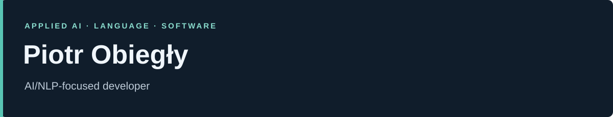

  

I build practical AI tools for language, documents, and everyday workflows.

My foundation is 10+ years in translation, localization, and multilingual product quality. Today, I build with Python, TypeScript, and LLMs, with a focus on useful applications and inspectable results.

[Website](https://piotrobiegly.com/) · [LinkedIn](https://www.linkedin.com/in/piotr-obiegly) · [Hugging Face](https://huggingface.co/Evanthel) · [Kaggle](https://www.kaggle.com/piotrobiegly)

## Selected work

### [SmartWatch](https://github.com/Evanthel/smartwatch-youtube-analyzer)
Chrome extension combining YouTube transcript retrieval with Gemini-based analysis guided by user-defined goals, persistent settings, and a side-panel interface.

`Chrome extension` `Gemini` `Transcript analysis` 
[Chrome Web Store →](https://chromewebstore.google.com/detail/smartwatch/fopiegopbjbnjkdddkebeopmjmkclbda)

### [Xenophon](https://github.com/Evanthel/xenophon-rag-agent)
Portfolio AI assistant built on Supabase/pgvector RAG, with inspectable planning, grounding verification, side-by-side evaluation, and an MCP server exposing the knowledge base.

`RAG` `Supabase / pgvector` `MCP` 
[Live demo →](https://evanthel.github.io/xenophon-rag-agent/)

### [PDF-to-JSON RAG](https://github.com/Evanthel/pdf-to-json-rag)
Local-first Python document workspace with a web UI and CLI for structured PDF extraction, OCR fallback, and multi-document retrieval, with page-level citations and reproducible benchmarks.

`Python` `Document AI` `OCR` 
[Live demo →](https://huggingface.co/spaces/Evanthel/pdf-to-json-rag-demo)

### [ShortsAI](https://github.com/Evanthel/shorts-ai)
Weather-aware outfit planner with shared React/Expo application logic, deterministic recommendation rules, and a constrained AI layer that explains the selected outfit.

`React / Expo` `Weather data` `Applied AI` 
[App Store →](https://apps.apple.com/us/app/shortsai-outfit-planner/id6802782916) · [Live demo →](https://shorts-ai-theta.vercel.app)

**More work:** [Polar Recovery Exporter](https://github.com/Evanthel/polar_recovery_exporter) — Python pipeline using the Polar AccessLink API to export daily recovery metrics to analysis-ready CSV.

## Toolkit

- **AI / NLP:** LLM workflows, RAG, agent workflows, MCP, embeddings, structured outputs, OCR
- **Development:** Python, TypeScript / JavaScript, React, Next.js, Expo, Pydantic, REST APIs
- **Data:** PostgreSQL, pgvector, ChromaDB, Supabase, Pandas
- **Testing & evaluation:** pytest, GitHub Actions, retrieval and faithfulness evaluation
- **Language & product quality:** Localization engineering, terminology management, multilingual product QA

Additional tools & libraries

**AI & analysis:** spaCy, PyTorch, Hugging Face, R, Jupyter Notebooks 
**Localization:** memoQ, Trados Studio, Lokalise, Phrase, Crowdin, Xbench 
**Workflow & quality:** Git, pgTAP, Jira, Linear, Confluence

